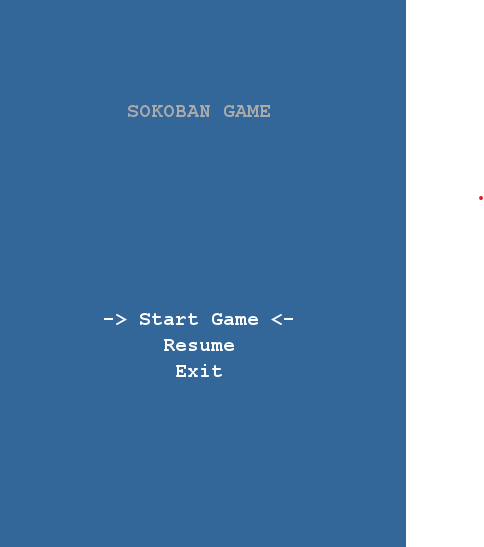
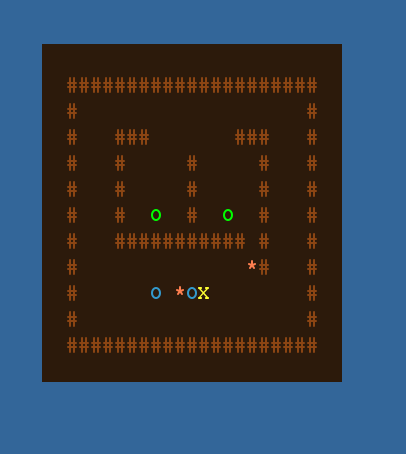
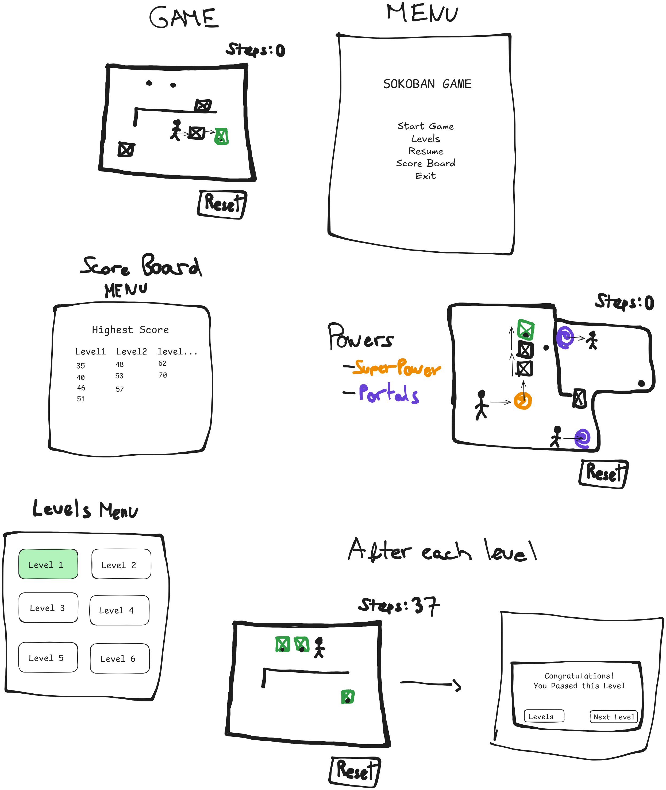

LDTS_T13_G07 - SOKOBAN

Game Description

This project is a Java-based implementation of the classic puzzle game Sokoban. The player controls a warehouse keeper whose goal is to push boxes to specific storage locations (targets). The game challenges the player's logical thinking and spatial awareness, as boxes can only be pushed (never pulled) and walls restrict movement.

The game features a level system that increases in difficulty, a main menu for navigation, and a collision system to enforce the game rules.

This project was developed by Martim Ferreira (up202403764@up.pt) and Afonso Vilas (up202403577@up.pt) for LDTS 2024-25.

Implemented Features

Main Menu: A navigational entry point that allows the player to start the game or exit the application.

State Management: The game utilizes the State Pattern to switch between the Menu, the actual Gameplay, and level transitions.

Level Loading: Levels are read dynamically from text files (.txt), allowing for easy creation and modification of maps without changing the source code.

Movement & Collision: The hero can move in four directions but is blocked by walls.

Box Interaction: The hero can push boxes if the space behind them is free. The system prevents pushing two boxes at once or pushing boxes into walls.

Win Condition: The level is completed when all boxes are placed on top of target positions. The game automatically detects this state and advances to the next level.

Visual Feedback: Elements have distinct colors, and boxes change color (Green) when placed correctly on a target.

Planned Features

Undo System: Implementation of the Command Pattern to allow players to reverse their last move.

Move Counter: An element to track the number of steps taken, adding a layer of optimization challenge.

Reset Level: Functionality to instantly restart the current level.

High Scores: Saving the best performance (fewest steps) for each level.

Addicional Powers like:
-SuperPower : Allow the player do move 2 Boxes at the same time.
-Portals: Allow the player and boxes to teleport to a diferente location inside the map.

Screenshots
The following screenshots illustrate the general look of our game:

Menu

  
 
 <b><i>Fig 1. Main Menu with options</i></b> 

Gameplay

  
 
 <b><i>Fig 2. Visual feedback when boxes are on targetst</i></b> 

Mockups (Current and future Features)
To guide the development of future features, we designed mockups illustrating the User Interface flow and new mechanics.

  

  <b><i>Fig 3. Sketches showing the Main Menu, Score Board, Level Selection, and new gameplay mechanics (Portals and Powers)</i></b>

Design Decisions shown in Mockups:
-Step Counter:** To introduce a resource management challenge.
-Reset Button:** Reset the current Level.
-Powers & Portals:** New puzzle elements to increase complexity in later levels.
-Level Selection:** A grid menu to allow players to replay specific levels.
-Score Board:** To save and display the best performance (High Scores).